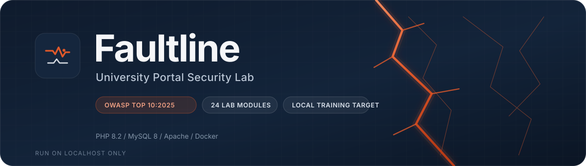
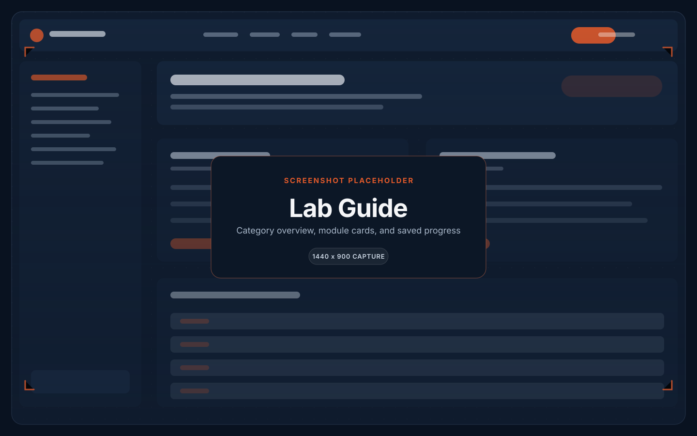
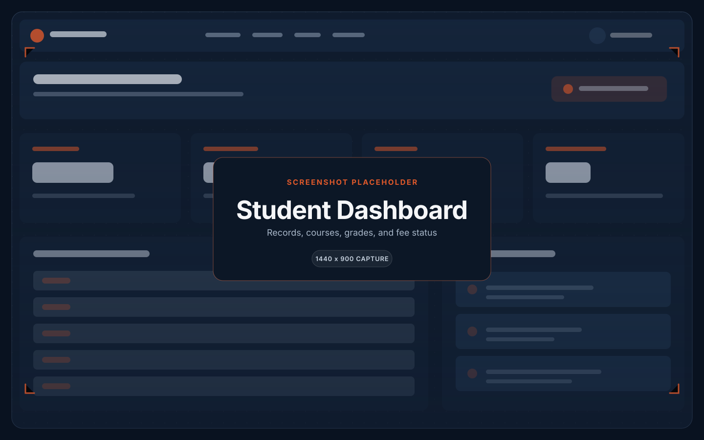
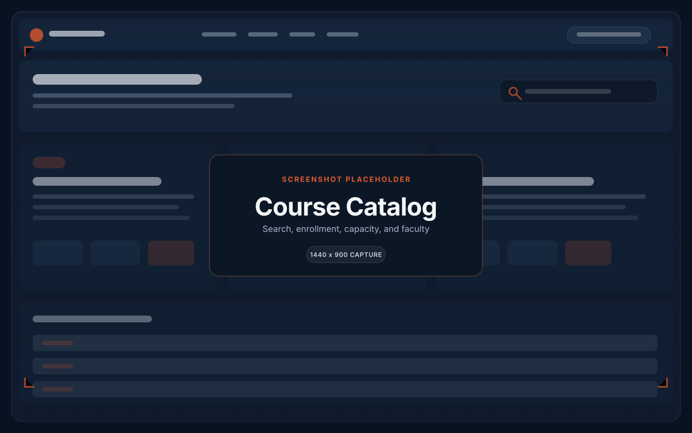
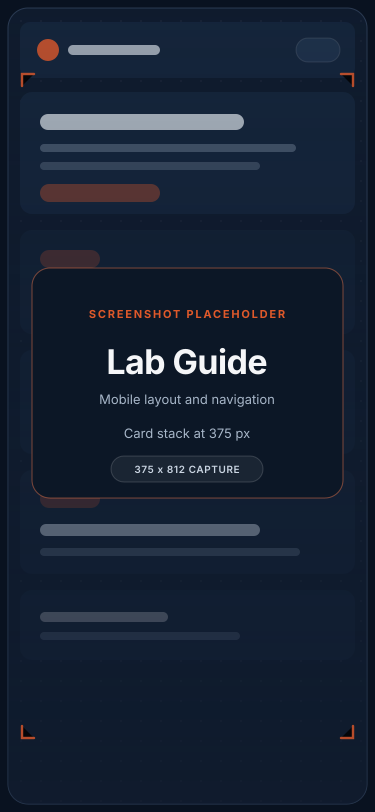
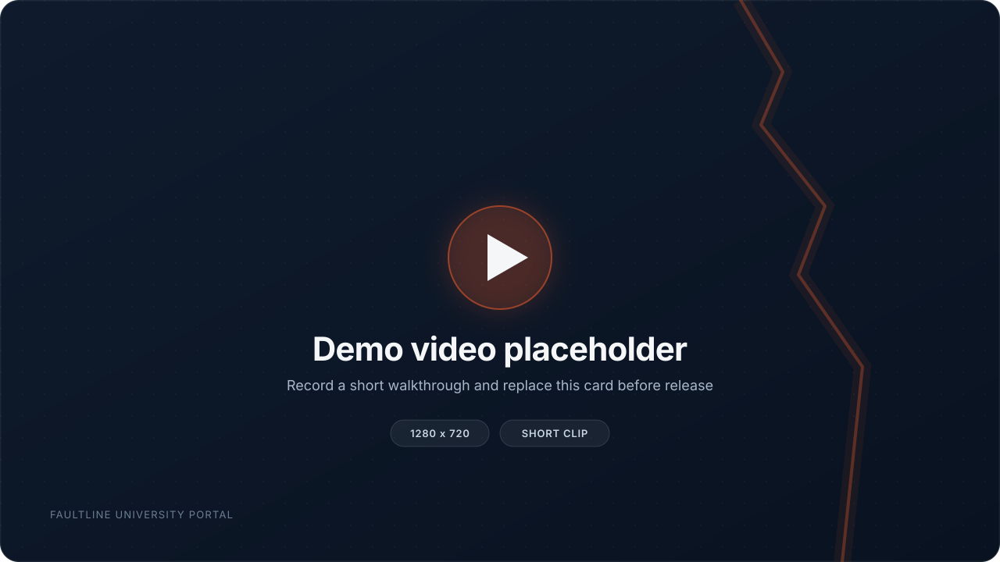

<div align="center">
  
  <br>
  <h1>Faultline University Portal</h1>
  <p><strong>A deliberately vulnerable PHP and MySQL lab for the OWASP Top 10:2025.</strong></p>
  <p>24 modules. 10 categories. One small university portal. Local Docker stack.</p>
  <p>
    <a href="#quick-start"></a>
    <a href="#owasp-top-102025-coverage"></a>
    <a href="https://www.php.net/"></a>
    <a href="https://www.mysql.com/"></a>
    <a href="LICENSE"></a>
    <a href="#safety"></a>
  </p>
  <p>
    <a href="#quick-start">Quick start</a> |
    <a href="#using-the-lab">Using the lab</a> |
    <a href="#owasp-top-102025-coverage">Coverage</a> |
    <a href="#screenshots">Screenshots</a> |
    <a href="docs/solutions.md">Solutions</a> |
    <a href="#safety">Safety</a>
  </p>
</div>

Faultline is an intentionally insecure campus application for security training. It looks and behaves like a small university system. Students hold records, faculty advise courses, administrators manage notices, and the portal handles grades, fees, uploads, API tokens, and operational logs.

The lab covers all 10 OWASP Top 10:2025 categories. Every category has at least two working modules. Each module has a clear objective, three hints, and a flag checked by the Lab Guide. Progress is stored in the browser.

The code is not a set of isolated demos. The modules share one application, one database, and one Docker network. Findings combine in realistic ways.

> **Warning**
> This application is insecure by design. Run it on localhost only. Do not deploy it to a server, a shared network, or a cloud host. Read [Safety](#safety) before the first build.

## At a glance

| | |
| --- | --- |
| Training target | Faultline University Portal |
| Modules | 24 |
| Categories | 10 of 10 OWASP Top 10:2025 |
| Difficulty split | 6 Easy, 14 Medium, 4 Hard |
| Stack | PHP 8.2, MySQL 8, Apache, Docker Compose |
| App URL | `http://127.0.0.1:8080` |
| Lab Guide | `/lab/` |
| Flag format | `FLT{...}` |
| Full spoilers | `docs/solutions.md` |
| License | MIT |

The seeded data is fictional. Names, national IDs, grades, fees, messages, and email addresses belong to invented people at `faultline.test`.

## OWASP Top 10:2025 coverage

 The matrix shows what each category asks the player to practice. The Lab Guide holds the module names, objectives, and hints.

| Category | Modules | What you practice | Level |
| --- | :---: | --- | --- |
|  A01 Broken Access Control | 3 | Object ownership, administrative functions, server side URL fetch | Easy to Hard |
|  A02 Security Misconfiguration | 3 | Exposed files, XML parsing, API headers and CORS | Easy to Medium |
|  A03 Software Supply Chain Failures | 2 | Package install, third party scripts, dependency and CI integrity | Easy to Medium |
|  A04 Cryptographic Failures | 2 | Reset token prediction, weak encoding and storage | Easy to Medium |
|  A05 Injection | 4 | SQL, script injection, shell injection, file inclusion | Medium to Hard |
|  A06 Insecure Design | 2 | Fee and coupon abuse, unsafe upload design | Medium |
|  A07 Authentication Failures | 2 | Token forgery, session fixation, remember me | Medium to Hard |
|  A08 Software or Data Integrity Failures | 2 | Unsafe deserialization, unsigned updates | Medium to Hard |
|  A09 Security Logging and Alerting Failures | 2 | Secrets in logs, log injection, missing alerts | Easy to Medium |
|  A10 Mishandling of Exceptional Conditions | 2 | Fail open authentication, verbose errors, unbounded input | Easy to Medium |

The current set is 24 modules. A new module must fit a category, ship a clear objective and three hints, add a hashed flag to the seed, and include a full entry in `docs/solutions.md`.

## Screenshots

These frames are placeholders. Replace them with captures from your own run. `assets/screens/README.md` lists the expected viewport for each file.

<table>
  <tr>
    <td width="50%" align="center">
      
      <br>
      <sub><strong>Lab Guide</strong> Category overview, module cards, and saved progress</sub>
    </td>
    <td width="50%" align="center">
      
      <br>
      <sub><strong>Student dashboard</strong> Records, courses, grades, and fee status</sub>
    </td>
  </tr>
  <tr>
    <td width="50%" align="center">
      
      <br>
      <sub><strong>Course catalog</strong> Search, enrollment, capacity, and faculty</sub>
    </td>
    <td width="50%" align="center">
      
      <br>
      <sub><strong>Mobile Lab Guide</strong> The same guide at 375 pixels wide</sub>
    </td>
  </tr>
</table>

## Demo video

A short walkthrough will replace this card before the public release.



## Quick start

### Requirements

- Docker Engine 24 or newer, or Docker Desktop with Compose v2
- A free port on `127.0.0.1:8080`
- 2 GB of memory for the stack
- A current browser with JavaScript enabled

### Start with Docker

```bash
git clone https://github.com/zer0k7/UniversityPortal_Security_Audit.git
cd UniversityPortal_Security_Audit
make up
```

If `make` is not installed, use the same Compose command directly.

```bash
docker compose up -d --build
```

Open `http://127.0.0.1:8080`. The first start builds the web image, initializes MySQL, and imports `db/schema.sql` and `db/seed.sql`. Allow 20 to 40 seconds on a cold build.

Check status and logs.

```bash
docker compose ps
make logs
```

Stop the lab without deleting its data.

```bash
make down
```

Reset the database, uploads, and themes.

```bash
make reset
```

`make reset` removes the named volumes and rebuilds the stack. Every account, grade, fee, upload, and installed theme returns to the seeded state.

The repository includes a demo `.env` on purpose. It holds the values used by the exposed files module. The file is tracked so the module is complete after a clone. Treat every value in it as public and disposable.

### Demo accounts

The seed includes one administrator, three faculty members, and twelve students. These credentials are intentionally weak.

| Role | Username | Password |
| --- | --- | --- |
| Administrator | `admin` | `admin123` |
| Faculty | `maya.okafor` | `faculty123` |
| Student | `student1` | `student123` |

All twelve student accounts use `student123`. The other faculty accounts use `faculty123`. Change nothing for normal lab use. The weak credentials are part of the training surface.

### Start without Docker

The Docker path is supported. The local path is useful when you want to debug PHP directly. Use one path at a time because both examples use port 8080.

Requirements:

- PHP 8.2 with `mysqli`, `pdo_mysql`, `zip`, and `simplexml`
- MySQL 8
- Apache or the PHP built-in server
- PowerShell 7 or a POSIX shell for the flag setup script

Create the database and load the schema.

```bash
mysql -u root -p -e "CREATE DATABASE IF NOT EXISTS faultline CHARACTER SET utf8mb4 COLLATE utf8mb4_unicode_ci;"
mysql -u root -p faultline < db/schema.sql
mysql -u root -p faultline < db/seed.sql
```

Create the flag files outside the web root.

```powershell
pwsh -File scripts/setup-flags.ps1
```

```sh
sh scripts/setup-flags.sh
```

Set the database values. The defaults are `localhost`, `root`, an empty password, and database `faultline`.

```bash
export DB_HOST=localhost
export DB_USER=root
export DB_PASS=
export DB_NAME=faultline
export FLAG_DIR=/flag
php -S 127.0.0.1:8080 -t .
```

```powershell
$env:DB_HOST = "localhost"
$env:DB_USER = "root"
$env:DB_PASS = ""
$env:DB_NAME = "faultline"
$env:FLAG_DIR = "C:\flag"
php -S 127.0.0.1:8080 -t .
```

Leave `BASE_URL` unset when the app is served from the document root. Set it when the app lives under a subdirectory, for example `BASE_URL=/faultline`. The application also tries to detect its own base path.

## Using the lab

1. Start the stack and open `http://127.0.0.1:8080`.
2. Open the Lab Guide at `/lab/`.
3. Choose a category and a module. Read the objective before you touch the app.
4. Use the first hint, then the second, then the third. Each module has exactly three.
5. Find the flag and paste it into the module card.
6. Continue through the category, then return to the guide to see your progress.

The Lab Guide checks every submission on the server against a SHA-256 hash in the `flags` table. It never sends the expected value to the browser. Completed modules are stored in `localStorage` for that browser and origin.

A good first pass is the shorter categories, then the larger injection set. The difficulty badge on each module is there to help you choose. Module names appear only in the guide, not in the main navigation.

When you are stuck or you have finished a category, read `docs/solutions.md`. It lists the location, the flaw, the vulnerability class, the OWASP category, the CWE, the flag location, and a fix idea. It does not contain patched module code. The shipped application stays vulnerable.

Do not enter real credentials, real personal data, or production URLs. Use the seeded accounts and fictional records.

## Architecture

```text
Browser
  |
  v
http://127.0.0.1:8080
  |
  v
web container: PHP 8.2, Apache, portal, Lab Guide
  |                         |
  v                         v
db container             internal container
MySQL 8, private         fake metadata, theme package,
named volume             CDN widget, update manifest,
                         private network only
```

Only the web port is published, and it binds to `127.0.0.1`. MySQL and the internal service have no host ports. The database, uploads, and themes use named volumes. The internal service resolves only on the Compose network.

The web container is not privileged. It does not mount the Docker socket. It does not mount a host path. Command injection, file upload, and theme installation still execute code inside the web container by design. The lab is contained, but it is not a hostile code sandbox.

## What is inside

- `lab/`: Lab Guide, module definitions, and the hash based flag checker.
- `docs/solutions.md`: full spoiler documentation for all 24 modules.
- `db/`: schema, fictional seed data, and hashed flags.
- `docker/`: PHP and Apache configuration, MySQL image, and the private internal service.
- `admin/`, `api/`: administrative tools and JSON endpoints.
- `scripts/`: flag setup, smoke checks, and local helpers.
- `assets/`: design system, banner, logo, and screenshot placeholders.

There is no host path mount and no published database port. Those choices are deliberate.

## Verification

Start the stack, then run the smoke checks.

```bash
make smoke
```

On Windows without `make`:

```powershell
pwsh -File scripts/smoke.ps1
```

Set `LAB_URL` to test another origin. The default is `http://127.0.0.1:8080`. The checks cover public pages, signed out routes, API endpoints, the Lab Guide, exposed files, and selected flag locations.

Static checks used during the build:

- All 42 PHP files parse with a PHP parser.
- All 24 flag hashes in the seed match their intended values.
- All 24 module keys match the seed and `docs/solutions.md`.
- The portal code does not add output encoding, prepared statements, password hashing, CSRF tokens, or role checks around the vulnerable modules.

Runtime checks require Docker. Use a disposable host or virtual machine. Do not run the smoke suite against a shared environment.

## Safety

**Faultline is deliberately insecure. It is not a starter kit, a template, or a production candidate.**

- Do not expose the app to the internet or an untrusted network.
- Keep the web port bound to `127.0.0.1`. Do not change it to `0.0.0.0`.
- Run the lab in a disposable VM or on a dedicated container host.
- Do not reuse any password, secret, key, or token from this repository.
- Do not point the internal service at real cloud metadata. The lab endpoints are fake.
- Disable GitHub Actions before you accept pull requests. The workflow in `.github/workflows/ci.yml` is an intentionally unsafe teaching artifact.
- Reset the volumes after upload, installer, and command injection work.
- Treat every flag and credential in this repository as public demo material.

The project has no warranty. You are responsible for where and how you run it.

## Contributing

Contributions are welcome when they preserve the purpose of the lab.

### Add a module

1. Pick an OWASP Top 10:2025 category with room.
2. Add the route and the vulnerable behavior.
3. Add the module to `lab/modules.php` with an objective and exactly three hints.
4. Add a flag hash to `db/seed.sql` and the matching flag value to its intended location.
5. Add a full entry to `docs/solutions.md` with location, flaw, CWE, and fix idea.
6. Keep the module name out of the main portal navigation. The Lab Guide is the index.
7. Run the PHP parse check and the smoke suite.
8. Confirm the app still works without a module selected or a database row present.

### Do not

- Replace a deliberate flaw with hardened code in the shipped branch.
- Add real personal data, real credentials, or telemetry.
- Add a dependency or workflow that can run untrusted code on a real host.
- Publish full spoilers outside `docs/solutions.md`. Player hints belong in `lab/modules.php`.

### Report a problem

The intentional weaknesses are the product. Do not report SQL injection, cross site scripting, or similar module behavior as a vulnerability.

Report an escape from the container, a published database port, a host path mount, a real secret, or a supply chain issue in the lab tooling. Open a GitHub issue without exploit details and include the affected file or service.

## Details

<details>
<summary>Why is the code still vulnerable?</summary>

The modules need working exploit paths. Prepared statements, output encoding, request tokens, password hashing, and access checks would remove the lessons. Fix ideas live in `docs/solutions.md`. Patched examples belong in a separate branch or a separate exercise.

</details>

<details>
<summary>Why is `.env` tracked in Git?</summary>

The exposed files module needs a real environment file in the web root. The committed file contains demo values only. It is not a template for a real deployment. Never copy this pattern into an application that faces a network.

</details>

<details>
<summary>Is the internal service a real cloud endpoint?</summary>

No. The private service returns fake metadata, a demo theme package, a widget script, and an update manifest. It has no published port. The only way to reach it is from inside the Compose network, which is the point of the SSRF module.

</details>

<details>
<summary>Can I use Faultline in a classroom?</summary>

Yes, when every student runs an isolated copy on localhost or in a disposable VM. Give each student their own stack and volumes. Do not share one database between groups. Do not put the lab on a conference network without an isolated VLAN and explicit permission.

</details>

<details>
<summary>Why does the repository contain an unsafe CI workflow?</summary>

The A03 category includes software supply chain failures. The workflow demonstrates an unsafe trigger, an unpinned action, and secret exposure. It is kept in the repository as teaching material. Disable Actions on the repository before accepting pull requests, and never attach a real deployment secret.

</details>

<details>
<summary>How do I reset progress and data?</summary>

Use `make reset` to rebuild the containers and named volumes. Clear site data for `127.0.0.1:8080` in the browser to remove the Lab Guide progress stored in `localStorage`.

</details>

## License

Released under the MIT License. See [LICENSE](LICENSE).

Brand marks and technology icons belong to their respective owners. The OWASP Top 10:2025 category names follow the published OWASP project.

<div align="center">
  
  <br>
  <sub>Faultline is a training lab. Keep it on localhost.</sub>
</div>
